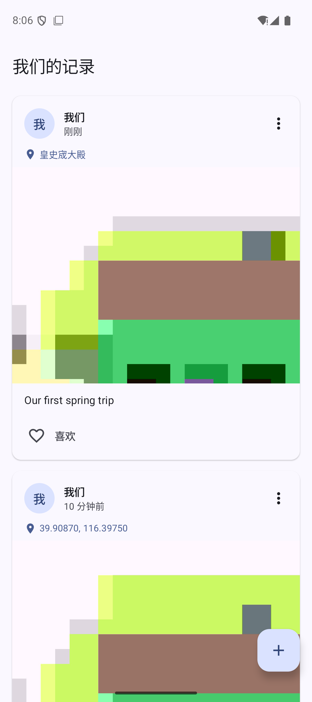
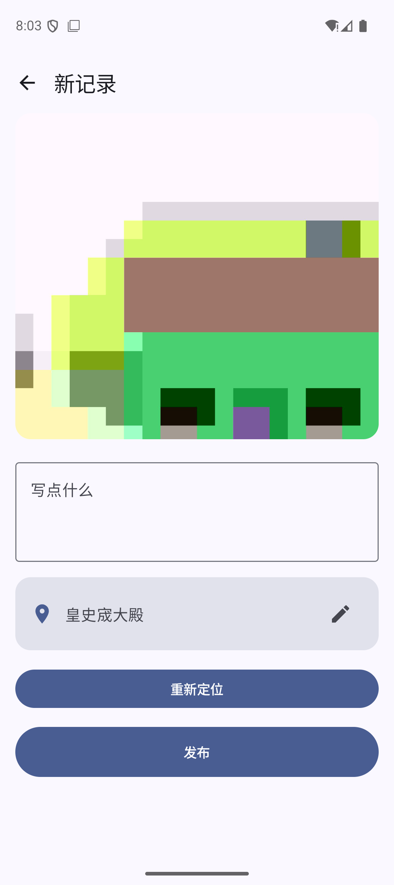
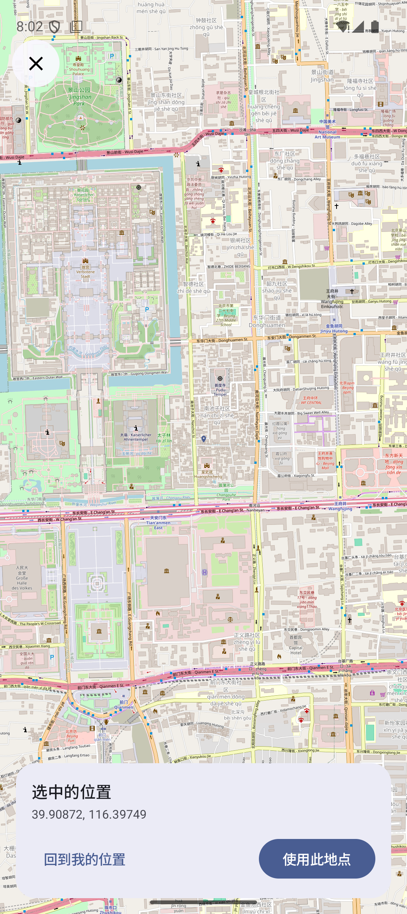

# 我们的记录

一个用来记录两个人日常的小 App：随手拍一张照片，自动带上时间和地点，像社交动态一样排成信息流。

## 界面预览

| 信息流 | 编辑发布 | 地图选点 |
| --- | --- | --- |
|  |  |  |

## 现在能做什么

- 📷 **拍照**：CameraX 相机预览 + 快门；只有前置/只有后置摄像头的设备会自动适配
- 📍 **地点**：进入编辑页自动定位，先显示坐标再解析地址；可以点地点进地图拖动微调，也能手动改名
- 📝 **发布**：照片（最多 9 张，可继续拍、删除、左右调整顺序）+ 配文 + 时间 + 地点写进本地数据库，按时间倒序展示；新记录发布后自动回到列表顶部
- ❤️ **信息流**：Facebook 风格卡片，按天分组且分组头吸顶，1/2/3+ 张自适应排版，支持点赞、删除（照片文件一并删除）
- 🔍 **详情页**：点卡片看大图（左右滑）、完整文字和地点只读地图；右上角删除（二次确认），不做编辑
- 🔒 **纯本地**：不需要登录；拒绝定位权限也照样能发；误触返回会弹「放弃这条记录？」二次确认

## 设计文档

实现新功能前先看这三份文档，避免边做边加：

| 文档 | 内容 |
| --- | --- |
| [产品需求（PRD）](docs/prd.md) | 定位、原则、功能清单（P0/P1/P2）、明确不做、成功标准 |
| [页面与交互](docs/ui-flows.md) | 信息架构、核心流程、线框、状态矩阵、交互规范 |
| [数据模型](docs/data-model.md) | 表结构、预留同步字段、Repository 契约、迁移方案 |

## 技术栈

| 模块 | 选择 |
| --- | --- |
| UI | Jetpack Compose + Material 3 |
| 架构 | 单模块 MVVM，手写 `AppContainer` 做依赖注入 |
| 数据库 | Room 2.8（KSP 注解处理） |
| 相机 | CameraX 1.6（core/camera2/lifecycle/view） |
| 定位 | 高德定位 SDK（GPS + WiFi + 基站混合，不依赖 Google 服务） |
| 地址解析 | 高德 `GeocodeSearch`：中文地址 + 附近 POI 列表 |
| 地图 | 高德地图 SDK（GCJ-02 坐标系，需在 `local.properties` 配置 `AMAP_KEY`） |
| 图片 | Coil Compose |
| 导航 | navigation-compose |

## 目录结构

```
app/src/main/java/com/example/myapplication/
├── MyApplication.kt          # Application + AppContainer（数据库/仓库/定位/照片存储）
├── MainActivity.kt
├── data/
│   ├── Post.kt               # Room 实体：配文、地点、时间、同步字段
│   ├── PostPhoto.kt          # 每条记录的照片（最多 9 张，按 position 排序）
│   ├── PostDao.kt
│   ├── AppDatabase.kt
│   ├── Migrations.kt         # Room v1 → v2
│   ├── PostRepository.kt     # 接口 + LocalPostRepository
│   ├── PhotoStore.kt         # 草稿 → 正式照片的文件管理
│   ├── PlaceSelection.kt
│   └── location/             # LocationClient / PlaceResolver + 两个接口（方便测试）
└── ui/
    ├── AppNavHost.kt         # feed → capture → compose → detail
    ├── feed/                 # 信息流、按天分组
    ├── camera/               # 相机
    ├── composer/             # 编辑发布 + 多图编辑 + 地点行
    ├── detail/               # 记录详情（只读 + 删除）
    ├── location/             # 高德选点 + 只读地点地图
    └── components/           # PostCard、权限工具
```

## 运行

### 先配 Key

地图/定位/逆地理都用高德，需要先申请 Key 并写进 `local.properties`（该文件不入库）：

```properties
AMAP_KEY=你的高德Android Key
```

Key 的「包名」填 `com.example.myapplication`，「安全码 SHA1」填实际签名 APK 的指纹
（`./gradlew :app:signingReport` 可查）。换签名后要同步新增 Key。

### Android Studio
直接点 Run 即可（`local.properties` 里要指向你的 SDK）。首次启动会先弹隐私合规页，同意后才会初始化高德 SDK。

### 命令行
本项目的 Gradle 守护进程要求 **JDK 25**（见 `gradle/gradle-daemon-jvm.properties`），Android Studio 自带的 JBR 就是 25：

```bash
export JAVA_HOME="/Applications/Android Studio.app/Contents/jbr/Contents/Home"
export GRADLE_USER_HOME="$PWD/.gradle-user-home"   # 可选：把缓存放进项目里
./gradlew :app:assembleDebug
```

APK 产物：`app/build/outputs/apk/debug/app-debug.apk`

## 测试

```bash
./gradlew :app:testDebugUnitTest         # JVM 单元测试（仓库、ViewModel、照片存储）
./gradlew :app:connectedDebugAndroidTest # 需要连上模拟器/真机（Room DAO）
```

## 在模拟器上手动验证

```bash
adb install -r app/build/outputs/apk/debug/app-debug.apk
adb shell pm grant com.example.myapplication android.permission.CAMERA
adb shell pm grant com.example.myapplication android.permission.ACCESS_FINE_LOCATION
adb emu geo fix 116.3975 39.9087        # 注意顺序是 经度 纬度
adb shell am start -n com.example.myapplication/.MainActivity
```

> - 模拟器用的是虚拟相机，拍出来是合成画面。
> - **高德定位在模拟器上通常拿不到结果**（没有 SIM/WiFi 基站信息），地图渲染和逆地理可以用固定坐标验证；定位精度请在真机上确认。
> - 逆地理失败（断网 / Key 未授权）时地点会退化为「纬度, 经度」，点地点右边的铅笔可以手动改名。
> - 国内网络下不再依赖 Google 服务，无需 GMS。

## 已知限制（v1 范围）

- 数据只存在本机，没有账号和云端同步，所以还做不到两台手机共享同一条时间线
- 没有评论、滤镜、视频
- 地图/逆地理依赖高德服务和网络；完全离线时只能按坐标选点，文字仍可手动填写
- 高德个人开发者免费配额：逆地理等 LBS 服务 15 万次/月、在线定位 150 万次/月、POI 搜索 5000 次/月（自实名认证起 1 年，超量按量计费）

## 后续可以加的功能

- 两个人配对 + 云端同步（需要后端和登录）
- 评论 / 表情回应
- 按地点聚合的"回忆地图"
- 相册时间线、纪念日提醒、桌面小组件
